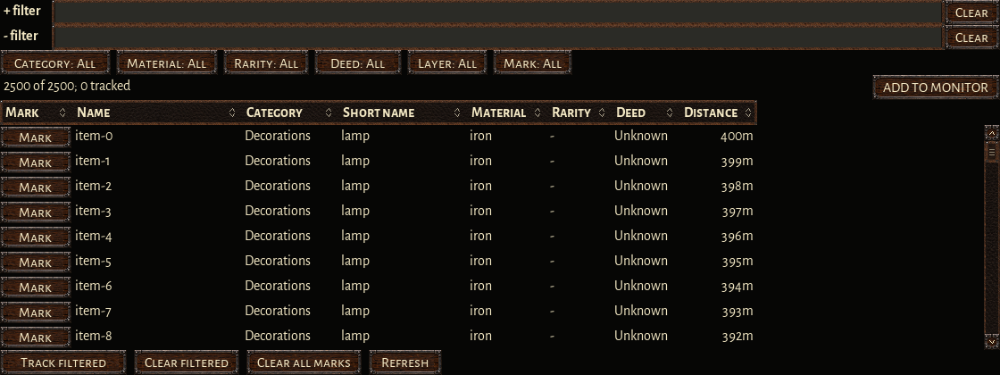

# Wurm Waypointer

Save places, follow targets and explore Wurm with world markers, maps and configurable highlights. A client mod for **Wurm Unlimited**.

**Version 1.10.11** · [Download the ZIP](https://github.com/chamomilo/wurm-waypointer/releases/latest) · [Release history](CHANGELOG.txt) · [Report a problem](https://github.com/chamomilo/wurm-waypointer/issues)


Click the compass to open Waypointer. Its eight tabs are **Waypoints**, **Mobs**, **Containers**, **Objects / items**, **Vehicles**, **My animals**, **Creatures Highlight** and **Tiles Highlight**. The pictures show the native interface with example data.

## Install or update

Requires a working **Wurm Unlimited client modloader**. Close Wurm before installing.

1. Download `wurm-waypointer-1.10.11.zip` from [Releases](https://github.com/chamomilo/wurm-waypointer/releases/latest).
2. Back up `mods/wurm-waypointer.config` and your `wurm-waypointer-data` folder.
3. Extract the ZIP into **WurmLauncher**, merging the `mods` directory. **Keep your existing `.config` when updating**; the included file supplies defaults for a new installation.
4. Replace `mods/wurm-waypointer.properties`. In `mods/wurm-waypointer`, remove older Waypointer JARs and keep `wurm-waypointer-1.10.11.jar`. Preserve saved data and other files.
5. Start the client and click the compass.

The installable ZIP contains only:

```text
mods/wurm-waypointer.properties
mods/wurm-waypointer.config
mods/wurm-waypointer/wurm-waypointer-1.10.11.jar
mods/wurm-waypointer/README.txt
```

The JAR includes the compass, artwork, fonts, shared updater and license notices. No separate resource pack or updater is required. Saved waypoints use `wurm-waypointer-data` by default; map and deed caches have their own configurable locations.

## Find, mark and follow

| Action | How |
| --- | --- |
| Create a waypoint | **ADD** in Waypoints, or left-click an empty place on the full map. |
| Show a marker | Use its **ON/OFF** control. |
| Navigate | Select **NAV** beside a target. **STOP** or `/wp nav off` ends navigation. |
| Share places | Use **COPY**, **SHARE**, **EXPORT**, **IMPORT** or **PASTE SHARED**. |
| Track animals or vehicles | Refresh the corresponding tab, then choose **Track**. |
| Configure the mod | **Main menu → Mod updates → Waypointer → Settings**. |

Filter waypoints by server, character, type or status. Click column headings to sort. Nearby tabs use objects received by the client. Tracked targets retain their last known position after leaving view; animal direction searches require the game's Manage/Find permissions.

Text filters ignore case and accept comma-separated fragments: `horse, wolf` matches either name. **+ filter** includes matches; **− filter** excludes them. Exclusions take priority. **TRACK FILTERED** applies to the full filtered result; **ADD TO MONITOR** watches matching targets.



**Large lists in 1.10.11:** Objects / items, Mobs, Containers, Waypoints, My animals, Vehicles, Monitoring, deed search and the compass target chooser create controls only for visible rows. Scrolling, search, sorting and bulk actions retain the complete list. Native interface checks cover 2500 entries in all four supported languages.

## Maps and routes

Press **M** for the full map. Drag to pan, scroll to zoom and choose **CENTER** to return to your character. Deeds, roads, marks and navigation have separate layer controls. Left-click an empty place to create a waypoint; right-click to add a map mark.

On recognized Sklotopolis worlds, **ALL MAPS ON SERVER** browses Liberty, Novus, Caza, Infinity Round 5 and Old Infinity, with published deed and highway data. Downloads refresh in the background.

Choose **MINI MAP** on the full map for a character-centred map. Its footer switches **GROUND/CAVE**, opens the full map and sets height contours: **1–99 metres**, or **0** to turn contours off. Scroll over the minimap to zoom.

Ground routes combine published highways with received terrain observations. Slope and water checks help choose a highway approach; fences, buildings and server permissions still determine access. Unloaded terrain can require a fallback route. Choose **Pulse**, **Solid** or **Moving dashes** in Settings.

## Creature highlights


Control outlines separately for players, animal groups, monsters, Unique creatures and conditions. Counts show detected matches. **ALL ON** and **ALL OFF** change outline switches. Choose **Color** to edit a rule: **Apply** saves; Cancel or closing keeps the previous colour. Condition colours take priority over Unique and category colours.


Unique, Champion and Diseased have independent **Auto-mark** switches. Each matching creature receives one tracked waypoint even when its outline is disabled. Auto-mark does not start navigation. Detection uses creatures received by the client on the surface or in caves.

## Terrain and meteorites


| Rule | Highlights |
| --- | --- |
| Non-rideable tiles | Slopes above 40 dirt (4 m), water deeper than 0.7 m, lava and cave openings. |
| Flower tiles | Flower-bearing terrain in its native flower colour. |
| Harvestable areas | Ripe crops and received harvestable fruit on eligible trees and bushes. |
| Overaged trees | Overaged and Shrivelled trees. |
| Meteors | Landed meteorites, with independent Auto-mark and Chime. |

Matching rules retain separate coloured borders. The four terrain switches start **OFF after each launch**; colours and radius persist. The default radius is **7 tiles along each axis**, a **15 × 15 square**. Change **Tile highlight radius** to **1–16** in Settings; it applies during play. Hover help explains terrain thresholds, crop stages and tree ages.

Meteorite outlines, Auto-mark and Chime default **ON** for new installations and respect saved choices. Detection uses loaded objects independently of terrain radius. Each new meteorite is marked and sounded once per session, without starting navigation.

## Settings, languages and updates

Open **Main menu → Mod updates** for the shared **Mods Registry**, then choose **Settings** on the Waypointer card. Navigation, maps, deed feeds, tracking, scanners, creature rules, terrain, meteorites, storage and diagnostics are all configured there.

Every setting has hover help. Valid edits save automatically and apply during play where supported. Startup-only changes show a restart notice: **Continue configuring** keeps Wurm open; **Exit game** opens its normal quit confirmation. Changing a storage path does not move existing files. See the [settings guide](docs/SETTINGS.md).

The shared language selector supports **English**, **Brazilian Portuguese**, **German** and **Russian**, with immediate changes for participating mods. This release embeds the complete canonical **Chamomilo updater 1.5.0** with **UI SDK 0.4.11**. Download and install updates manually with Wurm closed.

## Loot Maps, archaeology and scanners

Loot Map tracking follows the white rabbit from native readings. Archaeology tracks report targets, remembers confirmed cache locations per server and supports a completion chime. Scanners search animals, uniques or treasure with optional notifications and bounded outlines.

| Command | Purpose |
| --- | --- |
| `/wp nav off` | Stop navigation. |
| `/wp nav style pulse\|solid\|moving\|status` | Set or inspect the route effect. |
| `/wp scan animals\|uniques\|treasure` | Start a scanner profile. |
| `/wp scan off\|status\|window` | Stop, inspect or open the scanner. |
| `/wp scan notify on\|off\|status` | Configure notifications. |
| `/wp scan outline on\|off\|status` | Configure outlines. |
| `/wp deeds` or `/wp deeds refresh` | Open deed search or refresh its data. |
| `/wp perf` | Display performance counters. |

## Support and source

[Report a problem](https://github.com/chamomilo/wurm-waypointer/issues) with the mod version, reproduction steps, event time/timezone and client logs. Performance logs are in `wurm-waypointer-data/waypointer-diagnostics-*.log`; see [diagnostic instructions](docs/RENDER_DIAGNOSTICS.txt). Other mods can use the [public API](EXTERNAL_MOD_API.txt).

Build with **Java 8** and the Gradle wrapper. Configure client libraries using `local.properties.example`; provide JavaFX for native UI checks if absent from the JDK. The canonical updater defaults to `C:/projects/updater`; override with `CHAMOMILO_UPDATER_REFERENCE`. Set `-PchamomiloUiKitReference=/path/to/interface-items` for a different UI verifier checkout. Run `gradlew.bat clean build dist` on Windows or `./gradlew clean build dist` elsewhere. The ZIP is in `distribution/build/distributions/`. Proprietary client libraries are excluded.

Licensed under [GPL-3.0-only](LICENSE). [Third-party notices](THIRD_PARTY_NOTICES.txt) and the bundled fonts' SIL Open Font License remain inside the JAR.

Thanks to **Wolfbane** and **FlpSilva** for beta testing, and **Killerspike** for suggestions and detailed bug reports.
