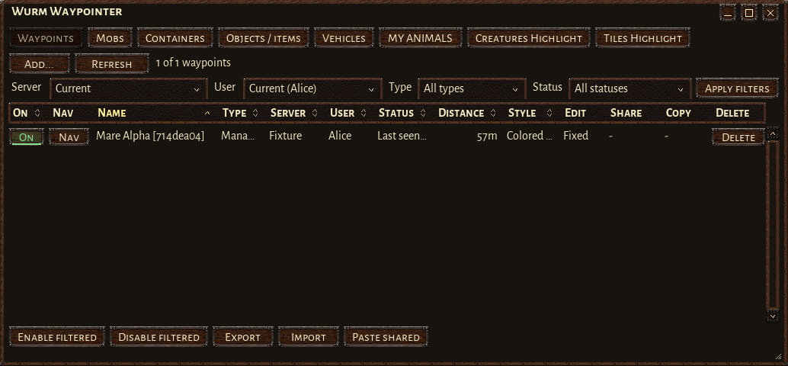
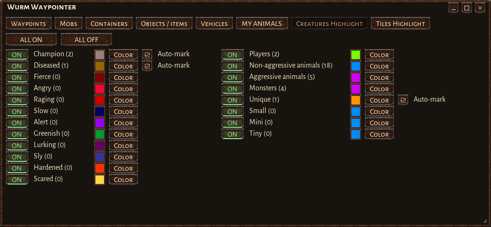
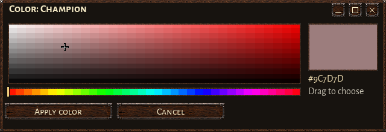
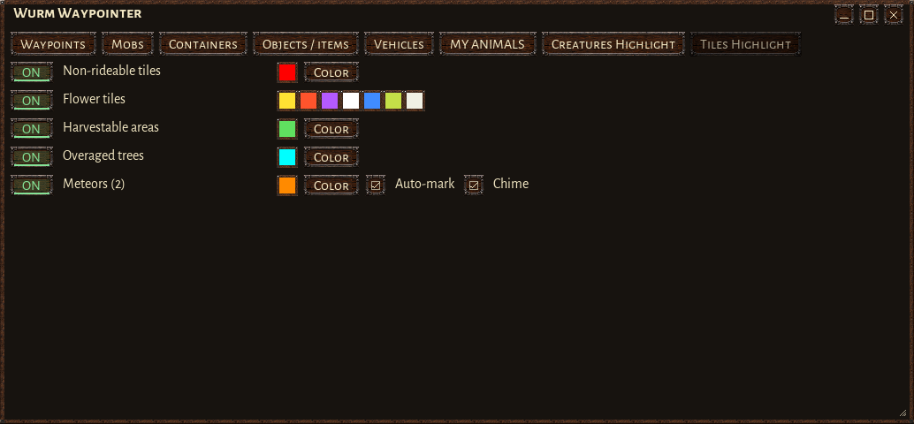

# Wurm Waypointer

Waypoints, navigation, maps and configurable highlights for the **Wurm Unlimited client**.

**1.10.9** · [Download](https://github.com/chamomilo/wurm-waypointer/releases/latest) · [Report an issue](https://github.com/chamomilo/wurm-waypointer/issues)



Keep places and tracked targets in one window, follow a route in the world, browse server maps and highlight nearby creatures or terrain. Click the compass to open the hub. The illustrations use example names and counts.

## Install and update

A working Wurm Unlimited **client modloader** is required. Close the client before installing.

1. Download `wurm-waypointer-1.10.9.zip` from the release page.
2. When updating, back up `mods/wurm-waypointer.config` and `wurm-waypointer-data`.
3. Extract the ZIP into `WurmLauncher`, merging its `mods` directory. Keep your existing `.config` when updating; the supplied file is a default for new installations.
4. Replace `mods/wurm-waypointer.properties`. In `mods/wurm-waypointer`, keep only the new `wurm-waypointer-1.10.9.jar`; remove older Waypointer JARs. Preserve your other files and saved data.
5. Start Wurm and click the compass.

The ZIP contains exactly these four files:

```text
mods/wurm-waypointer.properties
mods/wurm-waypointer.config
mods/wurm-waypointer/README.txt
mods/wurm-waypointer/wurm-waypointer-1.10.9.jar
```

Artwork, compass layers, fonts, the shared updater and license notices are inside the JAR. No separate image pack or updater installation is needed. Waypoints are stored in `wurm-waypointer-data` by default. Downloaded server maps and deed feeds have separate cache directories configured in Settings.

## First steps

| Action | Control |
| --- | --- |
| Open the hub | Click the compass. |
| Create a waypoint | **ADD** in Waypoints, or left-click an empty place on the full map. |
| Show or hide a waypoint | Its **ON/OFF** control. |
| Follow a target | **NAV** next to the target. |
| Stop navigation | **STOP**, or `/wp nav off`. |
| Open the full map | **M**. |
| Open the minimap | **MINI MAP** on the full map. |
| Change general preferences | **Main menu → Mod updates → Waypointer → Settings**. |

The hub contains **Waypoints**, **Mobs**, **Containers**, **Objects / items**, **Vehicles**, **My animals**, **Creatures Highlight** and **Tiles Highlight**.

## Waypoints and tracked targets

Save places, choose marker styles and share coordinates. The waypoint list supports editing, sorting, import, export and pasting shared waypoints. Server and character filters keep unrelated records out of the current view.

Nearby entity tabs show data received by the client. Refresh **My animals** or **Vehicles**, then choose **Track** or **Untrack**. Finding an animal's direction requires the game's Manage/Find permissions. A tracked target keeps its last known position after leaving view; its status distinguishes a current observation from an older position.

Text filters accept comma-separated fragments and ignore case. `horse, wolf` matches either name. A **+** filter includes matches; a **−** filter excludes them, and exclusions take priority.

## Maps and navigation

Press **M** to open the full map. Drag to pan, scroll to zoom and use **CENTER** to return to your character. Switch deed, highway, waypoint and navigation layers independently. Left-click an empty place to add a waypoint; right-click to add a map mark.

On recognized Sklotopolis worlds, **ALL MAPS ON SERVER** opens Liberty, Novus, Caza, Infinity Round 5 and Old Infinity, with their published deed and highway layers. Map downloads and refreshes run in the background.

The minimap follows your character and supports surface and cave views. Its footer switches **GROUND/CAVE**, opens the full map and sets height contours: **1–99 metres**, or **0** to disable them. Scroll over the minimap to zoom.

Ground navigation combines published highways with observed terrain. It checks received slope and water data when approaching a road. Pulse, solid and moving-dash route effects are available in Settings. Terrain observations do not establish fence access, building access or server permissions; unloaded terrain can require a fallback route.

In 1.10.9, dense map overviews retain their frame and toolbar, and Highway approaches can join a later reachable road section instead of making an unnecessary rectangular detour.

## Creature highlights



Choose outlines independently for players, animal categories, monsters, Unique creatures and individual creature conditions. Labels show detected counts. **ALL ON** and **ALL OFF** change outline switches.

**Color** opens a picker. **Apply** saves the choice; Cancel or closing the picker keeps the previous colour. Condition colours take priority over Unique and category colours.



Unique, Champion and Diseased also support **Auto-mark**. A matching creature creates one tracked waypoint even when its outline is disabled. Auto-mark does not start navigation. Detection uses creatures currently received by the client, on the surface or in caves.

## Terrain and meteorite highlights



| Rule | What it shows |
| --- | --- |
| Non-rideable tiles | Slopes above 40 dirt (4 m), water deeper than 0.7 m, lava and cave openings. |
| Flower tiles | Flower-bearing terrain in its native flower colour. |
| Harvestable areas | Ripe crops and received harvestable fruit on eligible trees and bushes. |
| Overaged trees | Overaged and Shrivelled trees. |
| Meteors | Landed meteorites, with independent Auto-mark and Chime options. |

Matching terrain rules keep separate coloured borders. The four terrain switches start **OFF after each client launch**; colours and radius are retained.

The radius defaults to **7 tiles along each axis**, a **15 × 15 square**. Set **Tile highlight radius** to **1–16** in the updater's Waypointer Settings. Changes apply during play. Hover help explains crop stages, tree ages and exact terrain thresholds.

Meteor outlines, Auto-mark and Chime default to **ON** for new installations; saved choices are respected. Meteor detection uses loaded objects and is independent of the terrain radius. Each newly detected meteorite is marked and sounded once per session, without starting navigation.

## Settings, language and updates

Open **Main menu → Mod updates** to display the shared **Mods Registry**, then choose **Settings** on the Waypointer card. All general Waypointer preferences are available there:

- Navigation appearance, highway use and route limits.
- Server maps, deed feeds and refresh intervals.
- Tracking retention, scanner filters, notifications and outline limits.
- Creature outline colours and Auto-mark rules.
- Terrain radius, terrain colours and meteorite actions.
- Storage paths and optional diagnostics.

Each setting has hover help. Valid changes save automatically and apply during play where supported. Changes requiring a restart display an explanation and offer Wurm's normal quit confirmation. See the [settings guide](docs/SETTINGS.md).

The registry's shared language selector supports **English**, **Brazilian Portuguese**, **German** and **Russian** and applies changes immediately to participating mods. This release includes the complete canonical **updater 1.5.0** and **Chamomilo UI 0.4.11**. Updates lead to release downloads for manual installation with the game closed.

## Loot Maps, archaeology and scanners

Loot Map tracking follows the white rabbit from native readings. Archaeology tracks report targets, remembers confirmed cache locations per server and supports a completion chime. Scanner profiles search animals, uniques or treasure, with optional notifications and bounded model outlines.

| Command | Purpose |
| --- | --- |
| `/wp nav off` | Stop navigation. |
| `/wp nav style pulse\|solid\|moving\|status` | Set or inspect the route effect. |
| `/wp scan animals\|uniques\|treasure` | Start a scanner profile. |
| `/wp scan off\|status\|window` | Stop, inspect or open the scanner. |
| `/wp scan notify on\|off\|status` | Set scanner notifications. |
| `/wp scan outline on\|off\|status` | Set scanner outlines. |
| `/wp deeds` | Open deed search. |
| `/wp deeds refresh` | Refresh published deed data. |
| `/wp perf` | Display performance counters. |

## Support and source

[Open an issue](https://github.com/chamomilo/wurm-waypointer/issues) with the mod version, event time and timezone, relevant map/highlight settings and client logs. Performance logs are stored in `wurm-waypointer-data/waypointer-diagnostics-*.log`; see [render diagnostics](docs/RENDER_DIAGNOSTICS.txt). Release changes are listed in the [changelog](CHANGELOG.txt). Other client mods can use the optional [public integration API](EXTERNAL_MOD_API.txt).

To build, use **Java 8** and the Gradle wrapper. Configure proprietary client libraries as described in `local.properties.example`; these libraries are not distributed. UI checks also need JavaFX when it is absent from the JDK. Set `CHAMOMILO_UPDATER_REFERENCE` to the canonical updater checkout when it is outside `C:/projects/updater`; use `-PchamomiloUiKitReference=/path/to/interface-items` for a different UI verifier location.

Run `gradlew.bat clean build dist` on Windows or `./gradlew clean build dist` elsewhere. The installable ZIP is written to `distribution/build/distributions/`. Release gates verify tests, native UI layout/input, exact updater and SDK embedding, and the four-file ZIP contents.

Licensed under **GPL-3.0-only**. [License](LICENSE) and [third-party notices](THIRD_PARTY_NOTICES.txt) are also embedded in the JAR. Bundled fonts retain their SIL Open Font License.

Thanks to **Wolfbane** and **FlpSilva** for beta testing, and **Killerspike** for suggestions and detailed bug reports.
